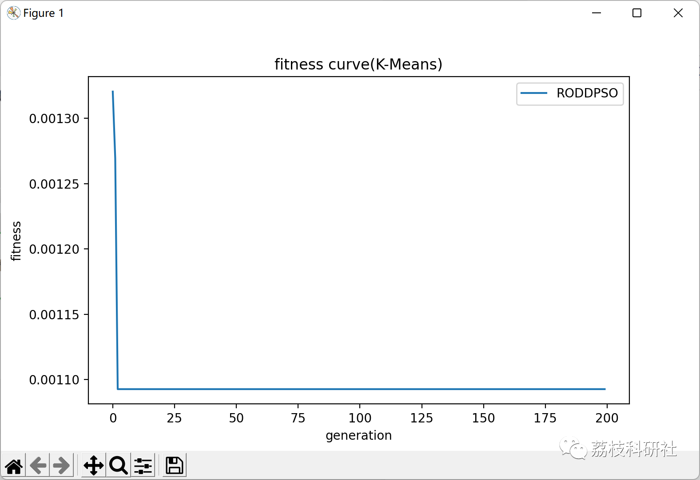
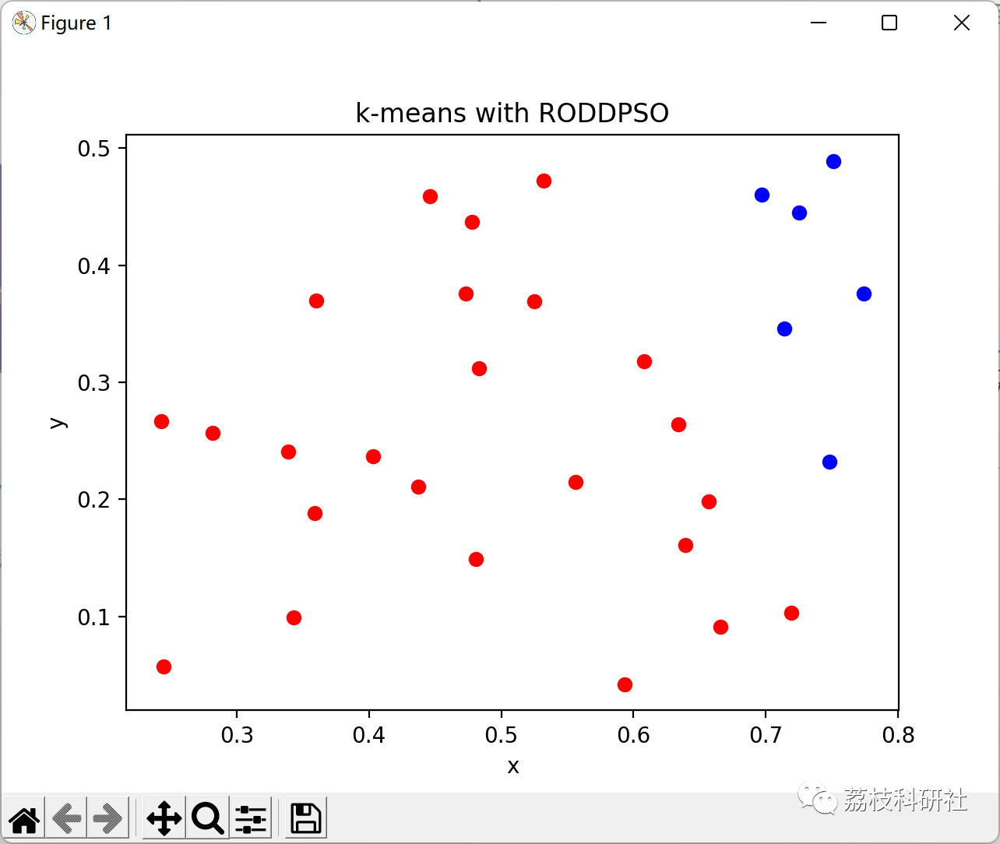

# Random Distributed Latency Particle Swarm Optimization (RODDPSO) + K-Means Algorithm (Python Code Implementation)

💥💥💥💞💞💞💞 Welcome to this blog❤️❤️❤️💥💥💥
🏆 Bloggers' Advantage: 🌞🌞🌞 The content of the blog strives to be rigorous in thought and clear in logic, for the convenience of readers.
⛳️ Mantra: The journey of a hundred miles is half done in the last ninety.
Litchi Research Society
Code Collection: Power System, Intelligent Algorithms and Applications, Neural Network Prediction, Path Planning, Optimized Scheduling, Workshop Scheduling, Image Processing, Signal Processing...
🎁Column Directory Link:
🌈🌈🌈🌟🌟🌟Electrical Code Intelligent Algorithm and Its Application Path Planning Neural Network Predictive Optimization Scheduling Image Processing Workshop Scheduling Signal Processing Romantic Her My Philosophical Thoughts Math Modeling Complete Code Matters
Contents
💥1 Overview
📚2 Running Results
🎉3 References
🌈4 Python code implementation
​  
💥1 Overview
This paper reproduces the algorithm RODDPSO+K-Means, using an optimized particle swarm algorithm to find the initial centroid of K-Means algorithm, in order to achieve the purpose of optimizing clustering algorithms.
The distributed time delay exhibits unique spatial properties, capable of simulating the propagation delay of signals through a certain number of parallel channels/paths over a specific time period. To date, the dynamics of complex systems with distributed time delays (e.g. neural networks [33], [44]) have been well studied. An intuitive idea is to introduce some distributed time delay into the PSO algorithm, hoping to enhance the ability to escape from local optima and overcome premature convergence issues. Compared to discrete time delays in [34], [36] and [48], distributed time delays have two advantages: 1) better utilization of longer (more cumulative) population evolution history, leading to better accuracy, and 2) more complex dynamic behavior reducing the likelihood of capturing local optima. Moreover, to strike a proper balance between convergence and diversity, the introduced distributed time delay can occur at a reasonable small probability. Therefore, the main purpose of this paper is to initiate a major research on a new type of random occurring distributed delay PSO (RODDPSO) algorithm and its application in healthcare information science.
Inspired by the above discussion, the aim of this paper is to propose a clustering algorithm based on RODDPSO and applied to analyze A&E data. The main contributions of this paper can be summarized in three aspects.
A new RODDPSO algorithm is introduced, where the randomly occurring distributed time delay items not only help: a) thorough exploration of the entire search space; b) significantly reduce the likelihood of capturing local optima; c) achieve an appropriate balance between local and global search capabilities.
A novel clustering algorithm combining traditional algorithms K - represents the clustering algorithm. The proposed RODDPSO-based clustering algorithm does not rely on the initial state of the clustering centroids, thereby facilitating better cluster partitions.
📚2 Run results
Partial code:
# Iterative Optimization
🎉4 References
W. Liu, Z. Wang, X. Liu, N. Zeng and D. Bell, "A Novel Particle Swarm Optimization Approach for Patient Clustering From Emergency Departments," in IEEE Transactions on Evolutionary Computation, vol. 23, no. 4, pp. 632-644, Aug. 2019, doi: 10.1109/TEVC.2018.2878536.  
🌈4 Python Code Implementation
Click the left bottom corner of this article to read the full text.

## Images

<!-- PAYMENT_BLOCK -->

## Get this dataset

- Payment link (Stripe): [Buy now](https://buy.stripe.com/3cs8yP7sY87d0vu9AB)
- Payment QR code: 

<!-- /PAYMENT_BLOCK -->
